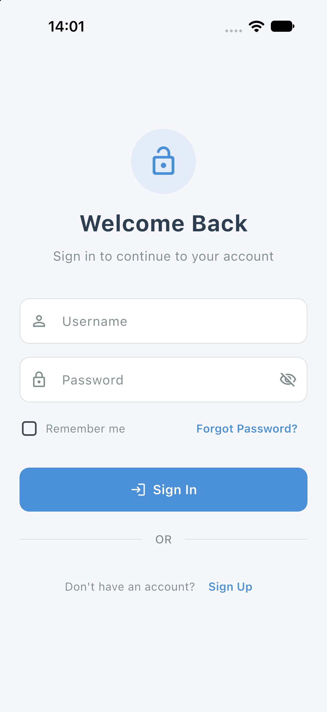
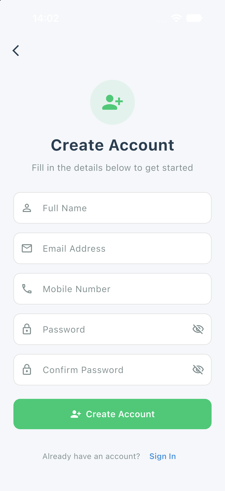
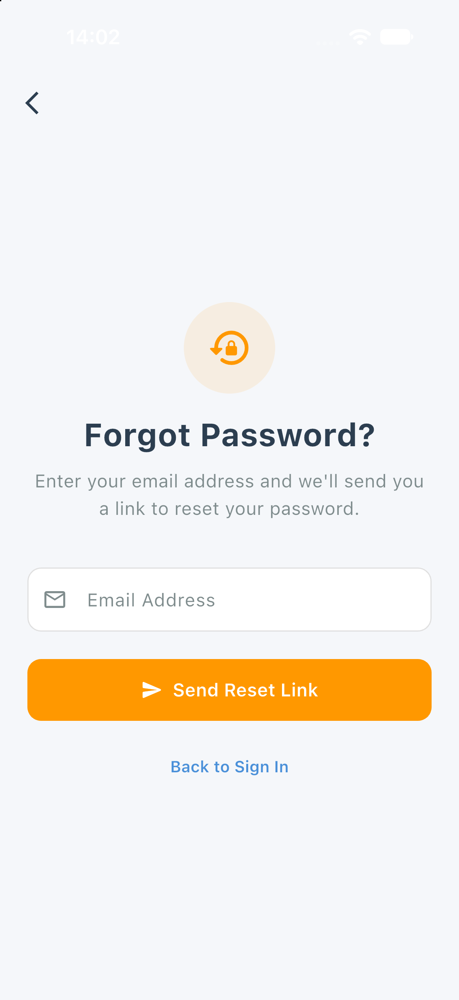
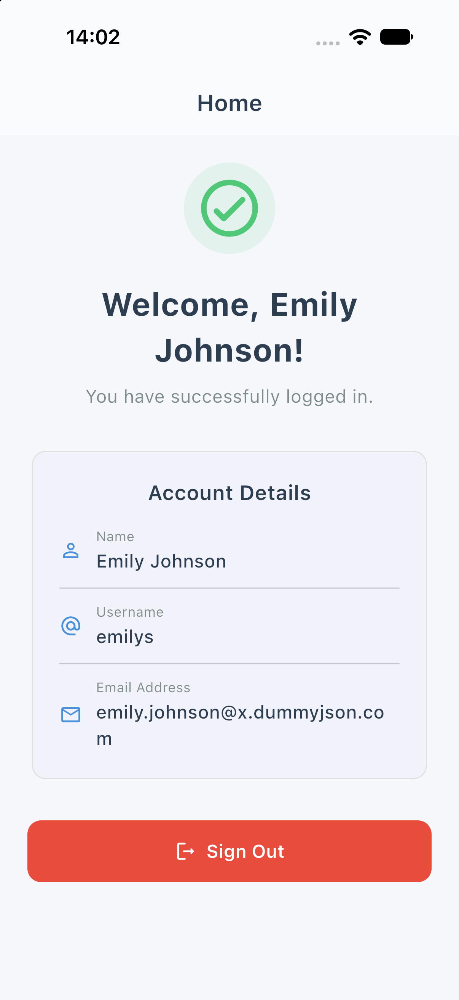
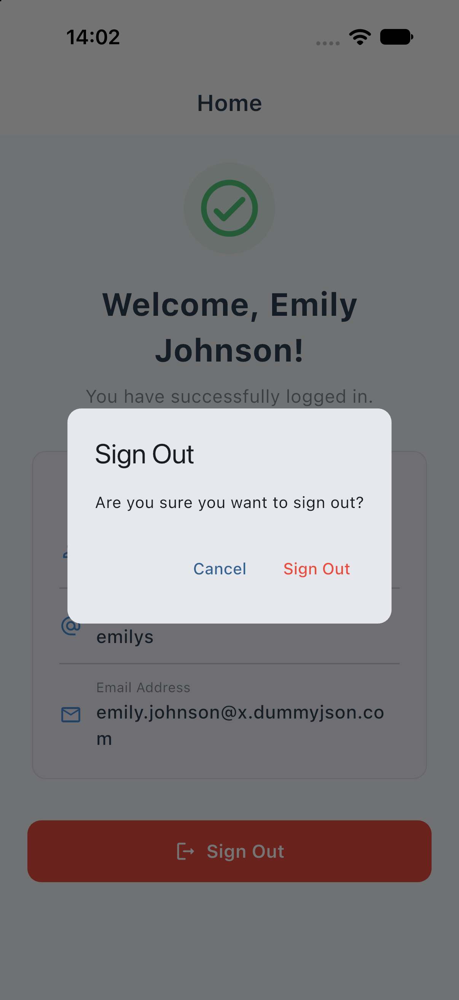
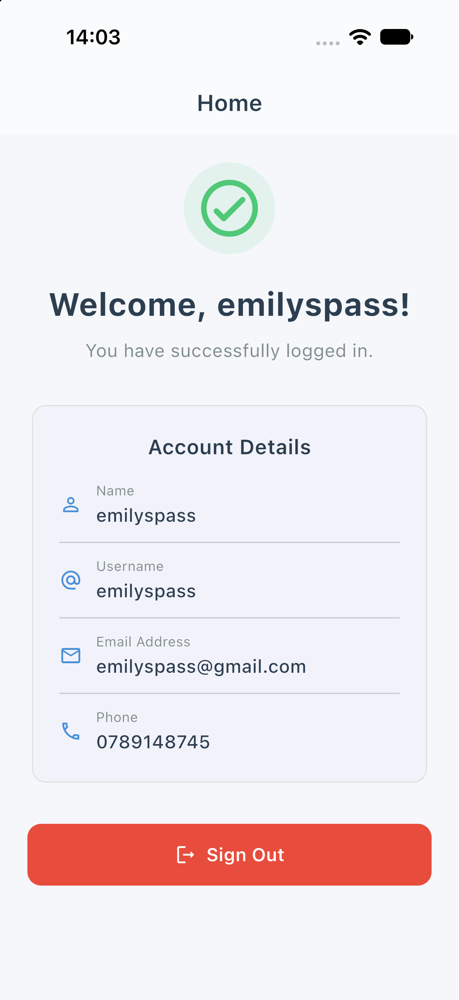

# Login & Registration Module

A fully functional, responsive login and registration module built with Flutter, following clean architecture and proper UI/UX practices.

## Screenshots

| Login | Register | Forgot Password |
| :---: | :---: | :---: |
|  |  |  |

| Home (API User) | Sign Out Confirmation | Home (Registered User) |
| :---: | :---: | :---: |
|  |  |  |

## Features

### Login Screen
- Email / mobile number input
- Password input with show/hide toggle
- "Remember me" checkbox
- Forgot password navigation
- Login button with loading indicator
- Form validation with descriptive error messages

### Registration Screen
- Full name input
- Email address input
- Mobile number input (10-digit, digits-only filter)
- Password with strength validation
- Confirm password with match validation
- Registration button with loading indicator

### Forgot Password Screen
- Email input with validation
- Reset link simulation
- Auto-navigates back after success

### Additional
- Mock API service (simulates network delay, duplicate checks, login failures)
- Proper navigation with `pushReplacement` / `pushAndRemoveUntil`
- SnackBar-based error & success messages
- Logout with confirmation dialog
- Responsive layout (constrained width, scrollable, `SafeArea`)

## Architecture

```
lib/
├── main.dart                     # Entry point, Provider setup
├── app.dart                      # MaterialApp & theme
├── models/
│   └── user_model.dart           # User data model
├── services/
│   └── auth_service.dart         # Mock API service
├── providers/
│   └── auth_provider.dart        # State management (Provider)
├── screens/
│   ├── login_screen.dart         # Login UI
│   ├── registration_screen.dart  # Registration UI
│   ├── forgot_password_screen.dart
│   └── home_screen.dart          # Post-login landing
├── widgets/
│   ├── custom_text_field.dart    # Reusable text field
│   ├── custom_button.dart        # Reusable primary & outlined buttons
│   ├── password_field.dart       # Password field with visibility toggle
│   └── loading_overlay.dart      # Loading overlay widget
└── utils/
    ├── constants.dart            # Colors, styles, spacing, regex
    └── validators.dart           # Centralized form validators
```

## Prerequisites

- **Flutter SDK**: `^3.47.8` (channel stable)
- **Dart SDK**: `^3.13.7`

## Tech Stack

- **Flutter & Dart** (Flutter 3.47.8 / Dart 3.13.7)
- **Provider** for state management
- **Dio** for network / API requests
- Material 3 theming

## API Integration

Login uses the **DummyJSON Auth API** (`https://dummyjson.com/auth/login`):
- Sends `POST` with `{ username, password }`
- Returns user profile + access/refresh tokens on success
- Returns `{ message: "..." }` on failure

Registration and Forgot Password use a **local mock service** (no public registration endpoint on DummyJSON).

## Getting Started

```bash
flutter pub get
flutter run
```

## Demo Credentials (Login)

| Field    | Value        |
|----------|--------------|
| Username | `emilys`     |
| Password | `emilyspass` |

More test users available at [dummyjson.com/users](https://dummyjson.com/users).

## Password Requirements

- Minimum 8 characters
- At least one uppercase letter
- At least one lowercase letter
- At least one number
- At least one special character (`@$!%*?&`)
